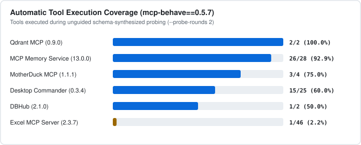
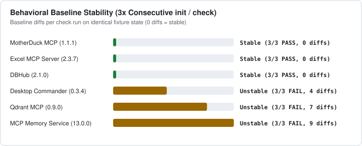

<p align="center">
  
</p>

# mcp-behave

**Runtime behavioral auditing and monitoring for Model Context Protocol (MCP) servers.**

[](https://github.com/navid72m/mcp-behave/actions/workflows/ci.yml)
[](https://pypi.org/project/mcp-behave/)
[](https://www.npmjs.com/package/mcp-behave)
[](https://registry.modelcontextprotocol.io/v0.1/servers?search=io.github.navid72m/mcp-behave)
[](LICENSE)

mcp-behave is a **CLI-first security tool** for checking what an MCP server actually does at runtime—not only what its tool schemas and descriptions claim. It exercises advertised capabilities, observes selected filesystem, network, and subprocess activity, inspects protocol payloads, and compares behavior against saved baselines.

<p align="center">
  <a href="demo.gif">
    
  </a>
</p>

---

## What Problem mcp-behave Solves

An MCP server can advertise a benign tool (such as a local formatter or read-only query helper) while its implementation reads credential files, spawns unexpected subprocesses, or initiates outbound network connections.

mcp-behave compares two views of a server:

- **Declared behavior:** tools, input schemas, annotations (`readOnlyHint`, `openWorldHint`, `destructiveHint`), resources, prompts, and manifest metadata exposed over MCP.
- **Observed behavior:** selected filesystem, network, and process activity captured while the server is probed or monitored inline.

A clean report means no covered issue was observed in the tested scenarios; it is **not** proof that a server is safe.

---

## Quick Start

### Install

```bash
# Run without permanent installation via uvx
uvx mcp-behave --version

# Or install the Python package
python -m pip install mcp-behave
mcp-behave --version

# Or install the npm launcher (requires Node.js 16+ and Python 3)
npm install -g mcp-behave
mcp-behave --version
```

### Important: Audits Execute Server Code

An audit actively launches the server and calls its tools. **Do not run an unfamiliar server against your host environment without isolation.** Default `--sandbox none` uses canary `$HOME` redirection and environment scrubbing, not OS isolation. Use `--sandbox docker` or `--sandbox podman` from a scratch directory with synthetic inputs when isolating untrusted code.

### One-Shot Audit & Inline Monitoring (`wrap`)

```bash
# One-shot audit (human, JSON, or SARIF output)
uvx mcp-behave audit python -m my_mcp_server
uvx mcp-behave --json --fail-on high python -m my_mcp_server
uvx mcp-behave --sarif python -m my_mcp_server > mcp-behave.sarif

# Generate a reviewed multi-server lockfile and run inline enforcement
uvx mcp-behave --lock --server-id my-server python -m my_mcp_server
uvx mcp-behave wrap --server my-server --lockfile mcp-behave.lock.json --enforce -- python -m my_mcp_server
```

Exit codes for audits: `0` (no findings at or above threshold), `3` (threshold met), `2` (tracing/setup failure), `1` (other errors).

---

## How It Works

```text
AI client  <---- stdio / JSON-RPC ---->  mcp-behave wrap  <---- stdio / JSON-RPC ---->  MCP server
                                                 |
                                                 +-- protocol monitoring & --enforce / --redact
                                                 +-- native tracing (DYLD / LD_PRELOAD / strace)
                                                 +-- policy attribution & JSONL / SQLite telemetry
```

- **Local tracing:** Uses `DYLD_INSERT_LIBRARIES` on macOS and `LD_PRELOAD` (falling back to `strace` if installed) on Linux. Remote transports (`--transport sse` / `streamable-http`) and container sandboxes (`--sandbox`) do not attach host syscall tracers.
- **Inline enforcement (`wrap --enforce`):** Requires a matching `mcp-behave.lock.json` entry; in default `fail-closed` mode it blocks unapproved `tools/call` requests, batch arrays, and malformed JSON, and replaces responses containing detected secrets or canaries (`--redact`).
- **Behavioral lockfiles:** `mcp-behave init` / `check` maintain single-server `mcp-behave.lock` baselines for CI diffing; `mcp-behave.lock.json` stores multi-server `wrap` policies (`mcp-behave approve --server <id>`).

See [ARCHITECTURE.md](ARCHITECTURE.md) for data flow, tracer backends, and bounded-queue design.

---

## Real-World Validation (`mcp-behave==0.5.7`)

Published **`mcp-behave==0.5.7`** (PyPI wheel SHA-256 `45ad1df9abd4f7efaa2311bc25ce1a571aaae2cc53ce36227ca74bebe268279b`) was evaluated against **6 independently maintained Python and Node.js MCP servers** inside isolated `--network none` Linux containers (`LD_PRELOAD` tracing, synthetic fixtures). See [VALIDATION.md](VALIDATION.md) for full methodology, per-server findings, false positives, and reproduction commands.

| MCP Server | Version | Automatic Tool Coverage | Controlled Scenarios | Behavioral Baseline | Detailed Report |
|---|---|---:|---:|---|---|
| **[MotherDuck](https://github.com/motherduckdb/mcp-server-motherduck)** | `1.1.1` | `3/4` (`75.0%`) | `7/7` | Stable (`0` diffs) | [MotherDuck report](VALIDATION.md#motherduck-mcp-v111) |
| **[Excel MCP Server](https://github.com/haris-musa/excel-mcp-server)** | `2.3.7` | `1/46` (`2.2%`) | `8/8` | Stable (`0` diffs) | [Excel report](VALIDATION.md#excel-mcp-server-v237) |
| **[Qdrant](https://github.com/qdrant/mcp-server-qdrant)** | `0.9.0` | `2/2` (`100.0%`) | `4/4` | Unstable (`7` diffs) | [Qdrant report](VALIDATION.md#qdrant-mcp-v090) |
| **[DBHub](https://github.com/bytebase/dbhub)** | `2.1.0` | `1/2` (`50.0%`) | `6/6` | Stable (`0` diffs) | [DBHub report](VALIDATION.md#dbhub-v210) |
| **[MCP Memory Service](https://github.com/doobidoo/mcp-memory-service)** | `13.0.0` | `26/28` (`92.9%`) | `8/8` | Unstable (`9` diffs) | [Memory Service report](VALIDATION.md#mcp-memory-service-v1300) |
| **[Desktop Commander](https://github.com/wonderwhy-er/DesktopCommanderMCP)** | `0.3.4` | `15/25` (`60.0%`) | `7/7` | Unstable (`4` diffs) | [Desktop Commander report](VALIDATION.md#desktop-commander-mcp-v034) |

- **What these terms mean:** *Automatic tool coverage* measures tools executed by unguided schema-synthesized probing; *controlled scenarios* exercise selected functional and permission-boundary operations under `wrap` and `wrap --enforce`; *behavioral baseline* checks whether 3 consecutive `init`/`check` runs produce zero diffs on identical fixture state.
- **Aggregate verified results:** **6/6** servers produced parseable `--json` and `--sarif` outputs; **40/40** controlled scenarios passed in `wrap` and `wrap --enforce`; **3/6** servers passed 3 consecutive `init`/`check` runs; deliberately introduced writes triggered `exit 3` across all 6 servers (subject to verifying the specific introduced write on unstable baselines); Python and Node.js runtime compatibility demonstrated.
- **Scope note:** Controlled scenarios represent selected operations, not exhaustive tool or attack coverage. Compatibility does **not** imply endorsement by upstream maintainers, and these results are **not** a security certification.





---

## Core Capabilities

- **Runtime activity:** selected filesystem opens/writes, network connection attempts, and subprocess launches.
- **MCP metadata & content:** manifest drift, annotation mismatches, prompt-injection patterns, invisible/bidi Unicode, terminal escapes, and external image references.
- **Canary & secret scanning:** configured canary tokens and secret patterns in inspected payloads.

| Command | Purpose |
|---|---|
| `mcp-behave audit` / `wrap` | One-shot behavioral audit or inline stdio proxy monitoring/enforcement. |
| `mcp-behave init` / `check` | Single-server `mcp-behave.lock` baseline generation and CI diffing. |
| `mcp-behave lint` / `inspect` | Static manifest linting or timeline inspection of prior audit output. |
| `mcp-behave scan-configs` / `audit-configs` | Inspect or actively audit servers in local MCP client configs. |
| `mcp-behave serve` | Expose `mcp-behave` tools over an allowlisted MCP server interface. |

---

## Performance and Benchmarks

`v0.5.7` builds on the `v0.5.6` runtime architecture (`pyc_atomic_temp` baseline matching, clean `stderr` progress routing, zero-length datagram drain fix). On `v0.5.6` (10 alternating paired repetitions, concurrent `--enforce --redact`, `n=200`, `c=16`, macOS arm64 with native DYLD tracing): median throughput improved from `185.4` to `1,266.2` RPS (`6.8×`) with `p50` latency dropping from `95.062` ms to `10.003` ms (`-89.5%`). A 1-hour bounded-retention soak completed `101,052` requests with `0` failures and `0` secret leaks (full-run completeness `UNVERIFIED` due to intentional pruning).

See [BENCHMARK.md](BENCHMARK.md) and [v0.5.6 benchmark evidence](benchmarks/results/v0.5.6/README.md) for methodology, 5-minute lossless soaks, and corpus reports.

---

## Security Model and Known Limitations

- **Implemented security practices:** Canary `$HOME` redirection and env scrubbing by default; explicit `--sandbox docker` / `podman` / `seatbelt` support; command allowlisting in `mcp-behave serve`; bounded 16 MiB framing and bounded telemetry queues. See [SECURITY.md](SECURITY.md).
- **Planned / experimental practices:** Production eBPF CO-RE packaging and namespace-level network/DNS capture remain planned in [ROADMAP.md](ROADMAP.md) (current `--tracer ebpf` is an experimental Linux prototype).

### Known Limitations (`v0.5.7`)

1. **Complex schema probing:** Automatic probing may fail to synthesize valid domain arguments (Excel MCP Server achieved `1/46` = `2.2%` automatic execution coverage).
2. **Stateful baseline noise:** Servers writing randomized cache, log, or PID-temp paths produce `init`/`check` diffs (`Qdrant`, `MCP Memory Service`, `Desktop Commander`); prefer `--scorecard` or `wrap --enforce` there.
3. **Telemetry loss under backpressure:** Non-blocking `AF_UNIX`/`SOCK_DGRAM` tracing can drop records during startup/subprocess bursts (Desktop Commander recorded `115` `telemetry_drop` events / `843` dropped records).
4. **Telemetry-loss attribution gap in `v0.5.7`:** Published `v0.5.7` does not propagate native `telemetry_drop` events into `AttributionEngine` confidence (`evidence_tier` and `attribution_incomplete`).
5. **Sensitive-path false positives:** Substring path rules flagged legitimate `@azure/identity/.../credentials/*.js` dependency files in DBHub (`24` `HIGH` alerts).
6. **Dynamic-response `MCP02` false positives:** Varying timestamps/counters across calls can trigger `MCP02` scope-escalation alerts (`MCP Memory Service`, `Desktop Commander`).
7. **Incomplete syscall visibility:** Native `LD_PRELOAD`/`DYLD` interposition hooks selected dynamically linked libc calls; statically linked binaries and direct syscalls can bypass it.
8. **Protocol enforcement is not OS sandboxing:** `wrap --enforce` filters JSON-RPC traffic; it does not isolate filesystem or network namespaces without `--sandbox`.
9. **Clean audits are not safety proofs:** Passing an audit or controlled scenario suite means no covered issue was observed in those tested paths.

See [VALIDATION.md](VALIDATION.md) for full details and per-server context.

---

## Integration Examples

Reproducible fixtures, `reproduce.sh` scripts, and example CI workflows (validated locally in Docker, not on GitHub-hosted runners):

- [Integration examples index](examples/integrations/README.md)
- [MotherDuck MCP `v1.1.1`](examples/integrations/mcp-server-motherduck/README.md)
- [Excel MCP Server `v2.3.7`](examples/integrations/excel-mcp-server/README.md)
- [Qdrant MCP `v0.9.0`](examples/integrations/mcp-server-qdrant/README.md)

---

## Documentation and Contribution

- **Architecture & Detection:** [ARCHITECTURE.md](ARCHITECTURE.md) · [docs/detection_matrix.md](docs/detection_matrix.md) · [docs/mcp_behave_technical_whitepaper.pdf](docs/mcp_behave_technical_whitepaper.pdf)
- **Security & Vulnerability Reporting:** [SECURITY.md](SECURITY.md) (private GitHub Security Advisories or `navid72m@gmail.com`)
- **Validation & Benchmarks:** [VALIDATION.md](VALIDATION.md) · [BENCHMARK.md](BENCHMARK.md) · [ROADMAP.md](ROADMAP.md)
- **Testing & CI:** [ci.yml](.github/workflows/ci.yml) (Linux and macOS test suites in [tests/](tests/))
- **Contributing:** [CONTRIBUTING.md](CONTRIBUTING.md) · [GitHub Issues](https://github.com/navid72m/mcp-behave/issues)
- **License:** MIT — see [LICENSE](LICENSE).

<!-- mcp-name: io.github.navid72m/mcp-behave -->
