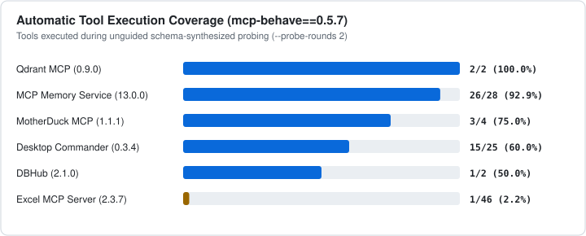
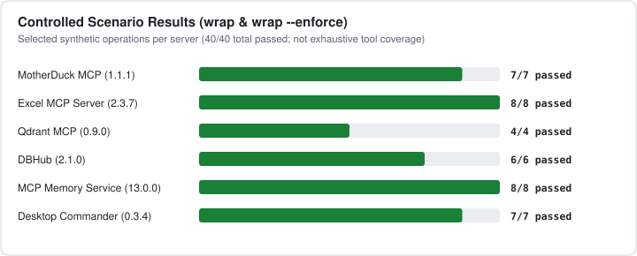
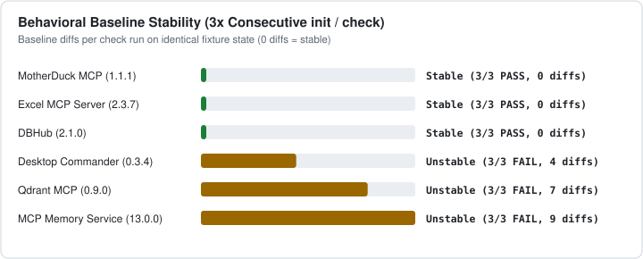
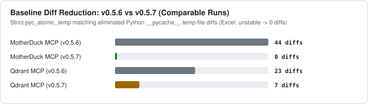

# Real-World Validation Report (`mcp-behave==0.5.7`)

> **Evidence boundary:** All measurements in this report are from **published `mcp-behave==0.5.7`** installed from PyPI (`mcp_behave-0.5.7-py3-none-any.whl`, SHA-256: `45ad1df9abd4f7efaa2311bc25ce1a571aaae2cc53ce36227ca74bebe268279b`) in isolated containers. Unpublished development fixes are not mixed into these results.

Compatibility with `mcp-behave` does **not** imply endorsement by upstream server maintainers, and passing selected synthetic scenarios does **not** constitute a security certification.

---

## 1. Evaluation Methodology

- **Tool under test:** `mcp-behave==0.5.7` (PyPI wheel SHA-256 `45ad1df9abd4f7efaa2311bc25ce1a571aaae2cc53ce36227ca74bebe268279b`, Python `3.12.16`).
- **Isolation:** Disposable Docker containers (`--network none`), non-root user `evaluser` (`uid=1000`), no local `mcp-behave` source mounts, and no `PYTHONPATH` overrides.
- **Runtime tracer:** Linux `LD_PRELOAD` native interposer (`/home/evaluser/.cache/mcp-behave/libmcpbehave_trace.so`).
- **Synthetic fixtures:** Local disposable `.duckdb`, `.xlsx`, `.sqlite`, Qdrant local storage, and workspace directories with zero real credentials or host mounts.
- **Automatic probing:** `mcp-behave --json --no-dns --probe-rounds 2` and `--sarif` to verify machine-readable `stdout` parsing, tool discovery, execution coverage, and heuristic/runtime findings.
- **Controlled scenarios:** Custom MCP client harness executing selected functional and boundary scenarios (`tools/list`, `tools/call`, expected error/permission rejections) across `direct`, `wrap`, and `wrap --enforce` modes.
- **Behavioral regression (`init` / `check`):** Fresh `mcp-behave init` baseline followed by 3 consecutive `mcp-behave check` runs on equivalent initial fixture state, plus a deliberate filesystem write test to verify regression detection (`exit 3`).

### Evidence Classifications Used in Reports

- **Directly observed:** Syscalls/events captured by `LD_PRELOAD` or protocol frames observed by `mcp-behave` (`evidence_tier: observed`).
- **Correlated:** Activity attributed across concurrent calls or uncertain boundaries (`evidence_tier: correlated`).
- **Heuristic:** Pattern-based warnings (e.g., unconstrained path schemas, `execute` tool-name keywords).
- **Confirmed:** Verified against target source code or controlled scenario outcomes.
- **False positive:** Triggered by benign dependency files or dynamic response payloads (documented per server below).
- **Known limitation / Unverified:** Capabilities or events outside `v0.5.7` coverage (e.g., dropped records under socket backpressure).

---

## 2. Cross-Server Comparison (`mcp-behave==0.5.7`)

| MCP Server | Version & Commit | Runtime | Auto Tool Coverage | Controlled Scenarios (`wrap` & `--enforce`) | JSON / SARIF | 3x Consecutive `init`/`check` | Deliberate Write | Telemetry Loss (`wrap` drops / records) |
|---|---|---|---:|---:|---|---|---|---|
| **[MotherDuck MCP](https://github.com/motherduckdb/mcp-server-motherduck)** | `1.1.1` (`181ad17`) | Python | `3/4` (`75.0%`) | `7/7` | Valid / Valid | **PASS** (`0` diffs) | Detected (`exit 3`) | `14` / `78` |
| **[Excel MCP Server](https://github.com/haris-musa/excel-mcp-server)** | `2.3.7` (`aa9c33d`) | Python | `1/46` (`2.2%`) | `8/8` | Valid / Valid | **PASS** (`0` diffs) | Detected (`exit 3`) | `1` / `11` |
| **[Qdrant MCP](https://github.com/qdrant/mcp-server-qdrant)** | `0.9.0` (`d858b29`) | Python | `2/2` (`100.0%`) | `4/4` | Valid / Valid | **FAIL** (`7` diffs) | Detected (`exit 3`) | `7` / `127` |
| **[DBHub](https://github.com/bytebase/dbhub)** | `2.1.0` (`dffb55f`) | Node.js | `1/2` (`50.0%`) | `6/6` | Valid / Valid | **PASS** (`0` diffs) | Detected (`exit 3`) | `22` / `150` |
| **[MCP Memory Service](https://github.com/doobidoo/mcp-memory-service)** | `13.0.0` (`d22f074`) | Python | `26/28` (`92.9%`) | `8/8` | Valid / Valid | **FAIL** (`9` diffs) | Detected (`exit 3`) | `12` / `210` |
| **[Desktop Commander MCP](https://github.com/wonderwhy-er/DesktopCommanderMCP)** | `0.3.4` (`9a101b17`) | Node.js | `15/25` (`60.0%`) | `7/7` | Valid / Valid | **FAIL** (`4` diffs) | Detected (`exit 3`) | `115` / `843` |

### Aggregate Summary

- **6/6** independently maintained Python and Node.js MCP servers produced valid, directly parseable JSON and SARIF outputs.
- **40/40** controlled scenarios passed across `wrap` and `wrap --enforce` modes (representing selected operations, not exhaustive tool or attack coverage).
- **3/6** servers (MotherDuck, Excel, DBHub) passed 3 consecutive `init`/`check` runs with `0` diffs; **3/6** failed due to randomized `$HOME`/temp-path writes.
- Deliberately introduced writes triggered `exit 3` across all 6 servers (on unstable baselines, the specific introduced write path was verified in the diff output).









---

## 3. Per-Server Evaluations

### MotherDuck MCP (`v1.1.1`)
- **Repository:** [motherduckdb/mcp-server-motherduck](https://github.com/motherduckdb/mcp-server-motherduck) (commit `181ad176d09993b10d6aa6073810a30fe12623db`)
- **Selection & scope:** Read-only SQL/DuckDB server tested against a synthetic local `sample.duckdb` fixture (no cloud credentials).
- **Coverage & scenarios:** `MEDIUM` audit confidence (`3/4` tools = `75.0%`); `7/7` controlled scenarios passed in `direct`, `wrap`, and `wrap --enforce` (list databases/tables/columns, view query, read-only write block, local `glob()` filesystem access, invalid table error).
- **Findings & false positives:** `0` confirmed security vulnerabilities; `1` heuristic `WARN` (`execute` keyword), `7` `INFO`; confirmed DuckDB `glob()` filesystem read in SQL read-only mode.
- **Baseline & telemetry:** `3/3` `init`/`check` passes (`0` diffs, down from `44` `__pycache__` diffs in `v0.5.6`); deliberate SQL `COPY` write exited `3`. `wrap` recorded `14` `telemetry_drop` events (`78` dropped startup records) and `0` `attribution_incomplete` events.
- **Integration example:** [examples/integrations/mcp-server-motherduck/README.md](examples/integrations/mcp-server-motherduck/README.md)

### Excel MCP Server (`v2.3.7`)
- **Repository:** [haris-musa/excel-mcp-server](https://github.com/haris-musa/excel-mcp-server) (commit `aa9c33d65d3967dd31723d165aa0526ccc952feb`)
- **Selection & scope:** Large-surface Python server (`46` tools) operating on `.xlsx` workbooks with `--allow-dir`.
- **Coverage & scenarios:** `LOW` audit confidence (`1/46` tools = `2.2%` auto-exec because generic probing uses placeholder paths rejected by `.xlsx` validation); `8/8` controlled scenarios passed in `wrap` and `wrap --enforce`, including `--allow-dir` traversal rejection and `=WEBSERVICE(...)` formula blocking.
- **Findings & false positives:** `0` confirmed security findings; `47` heuristic `WARN` (unconstrained path schemas) and `112` `INFO`.
- **Baseline & telemetry:** `3/3` `init`/`check` passes (`0` diffs); deliberate write exited `3`. `wrap` recorded `1` `telemetry_drop` event (`11` dropped records) and `0` `attribution_incomplete` events.
- **Integration example:** [examples/integrations/excel-mcp-server/README.md](examples/integrations/excel-mcp-server/README.md)

### Qdrant MCP (`v0.9.0`)
- **Repository:** [qdrant/mcp-server-qdrant](https://github.com/qdrant/mcp-server-qdrant) (commit `d858b297cdc1cabf7d7580e8d4c1618f89873fe5`)
- **Selection & scope:** Vector search server tested offline with `QDRANT_LOCAL_PATH` and pre-cached FastEmbed/ONNX model.
- **Coverage & scenarios:** `HIGH` audit confidence (`2/2` tools = `100.0%`); `4/4` controlled scenarios passed in `wrap` and `wrap --enforce`.
- **Findings & false positives:** `0` security findings; `4` `INFO`.
- **Baseline & telemetry:** `3/3` `init`/`check` runs exited `3` with `7` diffs each (down from `23` in `v0.5.6`) caused by `onnxruntime` cache writes under randomized `mcp_behave_canary_home_*`, `/tmp/<rand>`, and `deviceid.tmp.<uuid>`; deliberate write exited `3` (`9` diffs). `wrap` recorded `7` `telemetry_drop` events (`127` dropped startup records) and `0` `attribution_incomplete` events. Use `--scorecard` or `wrap --enforce` rather than `init`/`check` for CI gating.
- **Integration example:** [examples/integrations/mcp-server-qdrant/README.md](examples/integrations/mcp-server-qdrant/README.md)

### DBHub (`v2.1.0`)
- **Repository:** [bytebase/dbhub](https://github.com/bytebase/dbhub) (commit `dffb55f61866dfd6d168da58300cd19119aeb1dd`)
- **Selection & scope:** Node.js `v22.23.5` database server configured with `dbhub-ro.toml` (`readonly = true` over local SQLite).
- **Coverage & scenarios:** `MEDIUM` audit confidence (`1/2` tools = `50.0%`; `search_objects` succeeded, `execute_sql` rejected synthesized input); `6/6` controlled scenarios passed (`SELECT` queries, `INSERT`/`CREATE TABLE` blocked, invalid SQL rejected).
- **Findings & false positives:** **24 `HIGH` false positives** flagging `@azure/identity/dist/commonjs/credentials/*.js` dependency files because the path contains `credentials`; `1` heuristic `WARN` (`execute_sql`). Do **not** use `--fail-on high` on DBHub until path-rule false positives are resolved.
- **Baseline & telemetry:** `3/3` `init`/`check` passes (`0` diffs); deliberate write exited `3`. `wrap` recorded `22` `telemetry_drop` events (`150` dropped records) and `0` `attribution_incomplete` events.

### MCP Memory Service (`v13.0.0`)
- **Repository:** [doobidoo/mcp-memory-service](https://github.com/doobidoo/mcp-memory-service) (commit `d22f074da21d18385541bf2c77061d79518557b0`)
- **Selection & scope:** Python server (`sqlite-vec`, `onnxruntime`, pre-cached `all-MiniLM-L6-v2` model) tested offline.
- **Coverage & scenarios:** `HIGH` audit confidence (`26/28` tools = `92.9%`, `50/56` calls OK); `8/8` controlled scenarios passed (`memory_health`, `memory_stats`, `memory_store`, `memory_list`, `memory_search`, `memory_delete`).
- **Findings & false positives:** `0` outbound network connections; **1 `HIGH` false positive** (`MCP02` scope escalation on `memory_health` due to dynamic counters/timestamps); `2` `HIGH` + `2` `WARN` confirmed annotation/description mismatches (`memory_consolidate`, `mistake_note_update` declare `destructiveHint: false` while describing deletion).
- **Baseline & telemetry:** `3/3` `init`/`check` runs exited `3` (`9` diffs each from `$HOME/.cache/.../.onnxruntime/`, `.write_test`, `deviceid.tmp.<uuid>`); deliberate write exited `3` (`11` diffs). `wrap` recorded `12` `telemetry_drop` events (`210` dropped records) and `0` `attribution_incomplete` events.

### Desktop Commander MCP (`v0.3.4`)
- **Repository:** [wonderwhy-er/DesktopCommanderMCP](https://github.com/wonderwhy-er/DesktopCommanderMCP) (commit `9a101b17e44577f0baefa4c7120f087881c5cc56`)
- **Selection & scope:** Privileged Node.js filesystem and process server (`ripgrep` installed) inside strict `--network none` isolation.
- **Coverage & scenarios:** `MEDIUM` audit confidence (`15/25` tools = `60.0%`); `7/7` controlled scenarios passed (`set_config_value`, `read_file`, `write_file`, `start_search`, outside-allowed `read_file` blocked, benign `start_process`, `sudo id` blocked).
- **Findings & false positives:** Expected `HIGH` subprocess alerts (`/bin/sh`, `rg`, `python3`, `ps`); **2 `HIGH` false positives** (`MCP02` scope escalation on `list_searches` and `get_usage_stats` due to dynamic counters); expected `$HOME/.gitconfig` canary probe.
- **Baseline & telemetry:** `3/3` `init`/`check` runs exited `3` (`4` diffs each from `claude_tool_call.log`, `config.json.<pid>.tmp`, `.gitconfig`); deliberate write exited `3` (`9` diffs). `wrap` recorded `115` `telemetry_drop` events (`843` dropped records, including `75` events / `511` records during/after active tool calls) and `0` `telemetry_drop`-triggered `attribution_incomplete` events (`1` `attribution_gap` occurred only for `per_call_event_limit_exceeded` on `set_config_value`).

---

## 4. Known Limitations of Published `v0.5.7`

1. **Complex-input auto-probing:** Generic schema synthesis can fail on domain-specific constraints (e.g., Excel `.xlsx` paths yielded `2.2%` execution coverage).
2. **Stateful baseline instability:** Servers writing randomized `$HOME`/`.onnxruntime`/log/PID-temp files produce `init`/`check` diffs (`Qdrant`, `MCP Memory Service`, `Desktop Commander`).
3. **Telemetry backpressure & propagation gap:** Non-blocking `SOCK_DGRAM` transport drops records during startup/subprocess bursts (up to `115` events / `843` records on Desktop Commander). In published `v0.5.7`, `telemetry_drop` events do **not** propagate into `AttributionEngine` confidence (`evidence_tier` remains `observed` and `attribution_incomplete` is not set).
4. **False positives:** Sensitive-path substring rules flagged `@azure/identity/.../credentials/*.js` in DBHub (`24` `HIGH`); dynamic JSON counters triggered `MCP02` scope-escalation alerts in `MCP Memory Service` (`1` `HIGH`) and `Desktop Commander` (`2` `HIGH`).
5. **Observation & sandbox boundaries:** Libc interposition (`LD_PRELOAD`/`DYLD`) does not capture statically linked binaries or direct syscalls; protocol `--enforce` is not OS sandboxing; passing an audit does not prove a server is safe.

---

## 5. Reproducibility

The following commands were executed in isolated `--network none` containers with synthetic fixtures (see [examples/integrations/README.md](examples/integrations/README.md) for full `reproduce.sh` scripts):

```bash
# Executed: MotherDuck MCP v1.1.1 audit with published mcp-behave==0.5.7
docker run --rm --network none \
  -v ~/mcp-behave-evaluations/fixtures/motherduck:/fixtures/motherduck:ro \
  mcp-behave-eval-motherduck:1.1.1-v057 bash -c \
  'cp /fixtures/motherduck/sample.duckdb /workspace/sample.duckdb && mcp-behave --json --no-dns --probe-rounds 2 -- /opt/target-venv/bin/mcp-server-motherduck --db-path /workspace/sample.duckdb'

# Executed: Excel MCP Server v2.3.7 audit with published mcp-behave==0.5.7
docker run --rm --network none \
  -v ~/mcp-behave-evaluations/fixtures/excel:/fixtures/excel:ro \
  mcp-behave-eval-excel:2.3.7-v057 bash -c \
  'cp -r /fixtures/excel /workspace/excel_work && mcp-behave --json --no-dns --probe-rounds 2 -- /opt/target-venv/bin/excel-mcp-server stdio --allow-dir /workspace/excel_work/allowed'
```

Unverified example CI workflows (validated locally via Docker, not yet executed on GitHub-hosted runners) are documented in [examples/integrations/README.md](examples/integrations/README.md).
